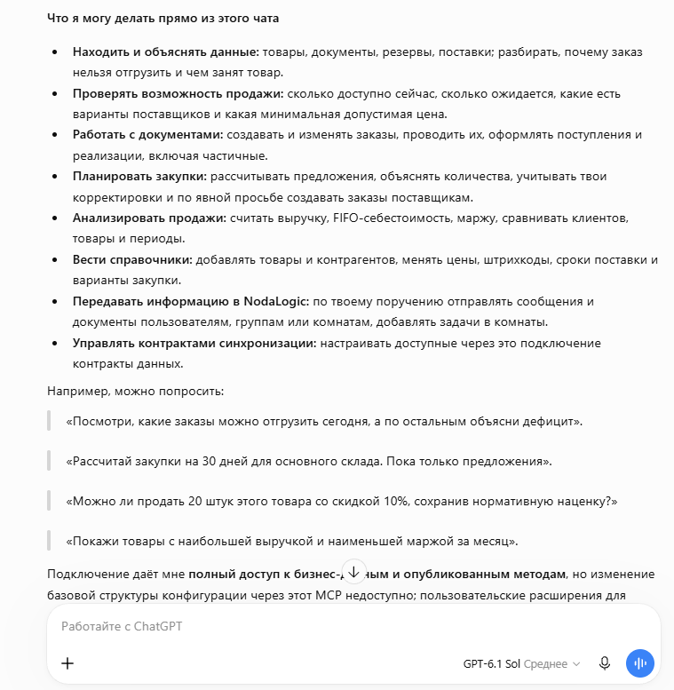

MCP-сервер уровня данных
========================

MCP-сервер уровня данных предоставляет внешнему AI-клиенту управляемый доступ
к одной развернутой конфигурации NodaLogic. Из чата можно читать и анализировать
бизнес-данные, создавать и изменять узлы, вызывать опубликованные методы и
запускать предусмотренные конфигурацией бизнес-операции.

Конфигурации NodaLogic строятся из узлов: узел одновременно хранит данные,
содержит метаданные класса и участвует в бизнес-логике. Поэтому подключенная
модель работает не только с «таблицами», но и с предметной моделью решения.
Семантические описания, промпты nGenie, классы, индексы и опубликованные методы
помогают ей понимать назначение данных и допустимые действия.

Для одной конфигурации можно создать несколько MCP-ссылок с разными именами и
правами. Например, отдельные подключения для аналитики, отдела продаж и
администратора.

.. important::

   MCP-ссылка может разрешать изменение и удаление данных. Выбирайте минимально
   необходимые права, подключайте только доверенный AI-клиент и отзывайте
   ссылку, если она больше не нужна.

Режимы доступа
--------------

``Full access``
   Подключение действует с правами владельца конфигурации. Ему доступны все
   видимые классы и узлы, опубликованные методы, прямое чтение QuantLedger и
   управление контрактами.

``As user``
   Подключение работает от имени выбранного пользователя. Его роли и правила
   RLS проверяются при каждом запросе, поэтому последующие изменения прав
   применяются автоматически.

``Allow user extensions``
   Дополнительная опция, разрешающая AI-клиенту создавать обычные
   пользовательские разделы, классы и узлы в пространстве расширений.
   Базовая схема конфигурации и обработчики при этом остаются неизменяемыми.

Перечень возможностей
---------------------

Конкретный набор доступных действий зависит от прав пользователя и устройства
конкретной конфигурации. В общем случае MCP-сервер позволяет AI-агенту:

* **Понимать конфигурацию и ее бизнес-логику.** Агент может изучить назначение
  решения, доступные разделы и классы, структуру данных, индексы, описания nGenie
  и опубликованные бизнес-операции.
* **Читать и искать данные.** Доступны просмотр отдельных узлов и списков,
  точные отборы по полям, поиск по индексам и текстовый поиск. Все результаты
  ограничиваются правами пользователя и RLS.
* **Читать данные QuantLedger.** При полном доступе агент может определять
  используемые пространства учета, получать точные и групповые остатки,
  движения, а также начальные остатки, приход, расход и конечные остатки за
  период. Эти инструменты работают только на чтение и только в пределах
  подключенной конфигурации. В режиме ``As user`` они не предоставляются,
  поскольку строки QuantLedger не содержат правил RLS узлов.
* **Создавать, изменять и удалять узлы.** Изменения проходят через штатный
  runtime NodaLogic и серверные обработчики конфигурации, а не записываются в
  базу в обход бизнес-логики.
* **Выполнять бизнес-операции.** Агент может вызывать опубликованные операции
  конкретного объекта или класса: например, проверку, расчет, проведение
  документа, резервирование или формирование связанного документа — если такие
  операции предусмотрены конфигурацией.
* **Анализировать данные с помощью nGenie.** Агент использует промпты, навыки,
  индексы и предметные описания конфигурации, может задавать уточняющие вопросы,
  подготавливать расчеты и, при явном поручении, выполнять действия.
* **Работать с сообщениями NodaLogic.** Доступны пользователи и группы,
  просмотр истории доступных групп, создание групп, управление участниками,
  отправка сообщений и передача реальных узлов-документов.
* **Работать с Rooms.** Агент может просматривать доступные комнаты, устройства
  и очереди объектов, передавать узлы в комнаты, добавлять и выполнять задачи.
  Создание, изменение и удаление Rooms требует отдельных прав управления.
* **Управлять контрактами синхронизации.** При полном доступе можно
  просматривать, создавать, изменять и удалять контракты по классам и глобальным
  индексам текущей конфигурации.
* **Создавать пользовательские расширения.** Если эта возможность разрешена
  для подключения, агент может создавать пользовательские разделы, классы и
  узлы, менять их представление и данные. Базовая конфигурация при этом остается
  неизменной.

Сервер всегда работает в пределах одной конфигурации. Он не позволяет изменять
ее базовую схему, обработчики, nGenie Code или Designer. Отправителем сообщений
всегда является фактический пользователь подключения; подменить его нельзя.

Пример возможностей на примере конфигурации «Торговля и склад в небольшой фирме»
----------------------------------------------------------------------------------

Например, ИИ-агент может решать такие задачи:

* находить товары, документы, резервы и поставки и объяснять, почему заказ пока нельзя отгрузить;
* проверять свободный остаток, ожидаемые поступления, варианты поставщиков и минимальную допустимую цену;
* создавать и изменять заказы, поступления и реализации, в том числе частичные, и вызывать опубликованные операции проведения;
* рассчитывать предложения по закупкам с учетом остатков, резервов, продаж, сезонности и сроков поставщиков;
* анализировать выручку, FIFO-себестоимость и маржу по товарам, клиентам и периодам;
* вести справочники товаров и контрагентов, цены, штрихкоды, сроки поставки и варианты закупки;
* по явному поручению отправлять сообщения, документы и задачи через NodaLogic;
* при полном доступе управлять контрактами синхронизации текущей конфигурации.

В этой конфигурации физические остатки, резервы, ожидаемые поступления,
движения и FIFO-себестоимость учитываются в QuantLedger. Поэтому при полном
доступе агент может читать эти учетные данные напрямую, а проводить документы
и изменять учет — только через опубликованную бизнес-логику конфигурации.

Примеры запросов
~~~~~~~~~~~~~~~~

* «Проверь, какие заказы можно полностью или частично отгрузить сегодня. Для остальных покажи дефицит по товарам и ожидаемые даты поступления».
* «Рассчитай потребность основного склада на 30 дней. Покажи исходные остатки, резервы, ожидаемые поступления и обоснование каждого количества. Ничего не создавай».
* «Можно ли продать 20 единиц этого товара со скидкой 10 %, не нарушив минимальную наценку? Покажи расчет и доступный остаток».
* «Сравни выручку, FIFO-себестоимость и маржу по товарам за текущий месяц. Отдельно покажи лидеров по выручке и позиции с минимальной маржой».
* «Подготовь проекты заказов поставщикам по согласованному расчету и перед созданием покажи итоговый список на подтверждение».

Настройка подключения
----------------------

Настройка MCP в NodaLogic
~~~~~~~~~~~~~~~~~~~~~~~~~

1. Откройте редактор нужной конфигурации и выберите пункт ``MCP Server``.

   .. image:: _static/create-mcp-server.png
      :align: center
      :alt: Пункт MCP Server в редакторе конфигурации
      :width: 100%

2. Выберите способ подключения:

   * **OAuth.** Включите ``OAuth access (optional)`` и скопируйте стабильный
     endpoint вида ``https://HOST/mcp/config/<configuration_uid>``. Отдельный
     секрет создавать не требуется: пользователь войдет в NodaLogic при
     подключении клиента.
   * **MCP-ссылка с токеном.** В блоке ``Create MCP access link`` укажите:

     * ``Name`` — понятное назначение подключения, например ``ChatGPT — продажи``;
     * ``Access`` — ``Full access`` или доступ от имени выбранного пользователя;
     * ``Allow user extensions`` — включайте только если AI-клиенту действительно нужно создавать пользовательские расширения.

     Нажмите ``Create link`` и сразу скопируйте готовый MCP URL. Полный секрет
     показывается только один раз. При необходимости можно использовать
     стабильный endpoint вместе с показанным Bearer-токеном.

   .. image:: _static/create-access-link.png
      :align: center
      :alt: Создание и копирование MCP-ссылки с токеном
      :width: 100%

.. warning::

   Считайте готовый MCP URL паролем. Не публикуйте его в документации,
   сообщениях, журналах или скриншотах. Если секрет утрачен или раскрыт,
   отзовите ссылку кнопкой ``Revoke`` и создайте новую.

Авторизация
~~~~~~~~~~~~

Обычный MCP поддерживает два независимых варианта авторизации.

**OAuth** включается владельцем как опция для конкретной конфигурации.
Пользователь входит в NodaLogic на странице самого сервера и явно разрешает
доступ. Владелец получает полный доступ; остальные пользователи работают со
своими текущими ролями и RLS. Пароль не передается ChatGPT. Если OAuth выключен,
сервер не публикует для этой конфигурации OAuth-регистрацию и принимает только
ранее выданные MCP-токены.

**MCP-ссылка с токеном** заранее фиксирует режим ``Full access`` или ``As user``.
Готовый URL уже содержит секрет подключения; вместо него клиент может передать
тот же секрет как Bearer-токен стабильному endpoint. Отключение OAuth не
отзывает такие ссылки. Каждая ссылка отзывается отдельно кнопкой ``Revoke``.

Подключение в ChatGPT
~~~~~~~~~~~~~~~~~~~~~

Названия и расположение элементов интерфейса ChatGPT могут меняться. На момент
подготовки статьи последовательность выглядит так:

1. Откройте страницу управления плагинами. В меню ``Добавить`` выберите
   ``Добавить пользовательский сервер MCP``.

   .. image:: _static/chatgpt-add-mcp.png
      :align: center
      :alt: Команда добавления пользовательского MCP-сервера
      :width: 60%

2. Для интерактивного подключения через включенный OAuth заполните карточку:

   * задайте имя и, при необходимости, описание и значок;
   * выберите подключение по URL сервера;
   * вставьте стабильный endpoint вида
     ``https://HOST/mcp/config/<configuration_uid>``;
   * выберите ``OAuth`` в поле аутентификации;
   * прочитайте предупреждение, подтвердите подключение доверенного сервера и нажмите ``Создать в виде плагина``.

   .. image:: _static/chatgpt-connection-settings.png
      :align: center
      :alt: Параметры подключения пользовательского MCP-сервера
      :width: 80%

3. На странице авторизации проверьте запрашиваемые права и учетную запись.
   Если все верно, нажмите ``Войти и разрешить подключение``.

   .. image:: _static/chatgpt-authorize.png
      :align: center
      :alt: Авторизация обычного MCP-сервера одной конфигурации
      :width: 55%

Если используется MCP-ссылка с токеном и клиент поддерживает такой способ,
передайте ему готовый MCP URL либо стабильный endpoint и Bearer-токен. OAuth в
этом случае выбирать не нужно. Не вст
